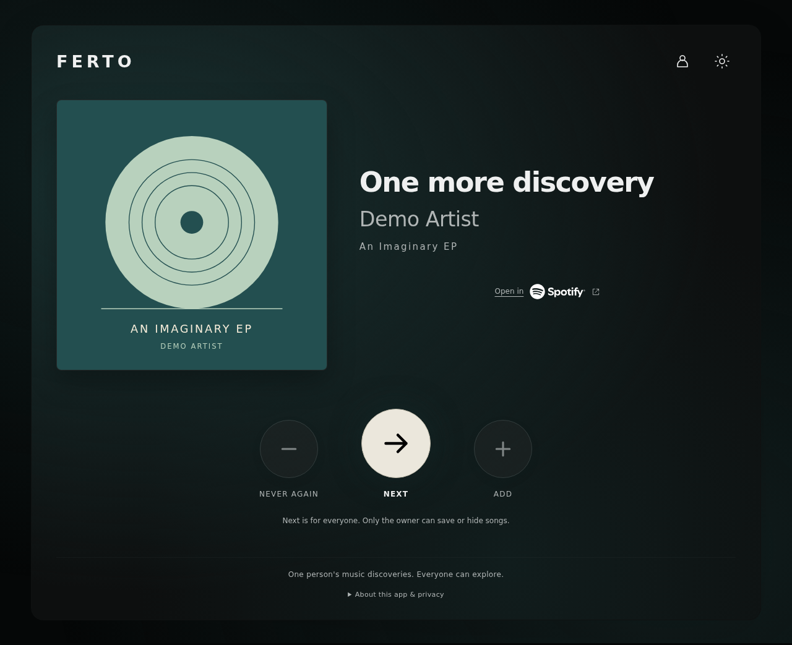
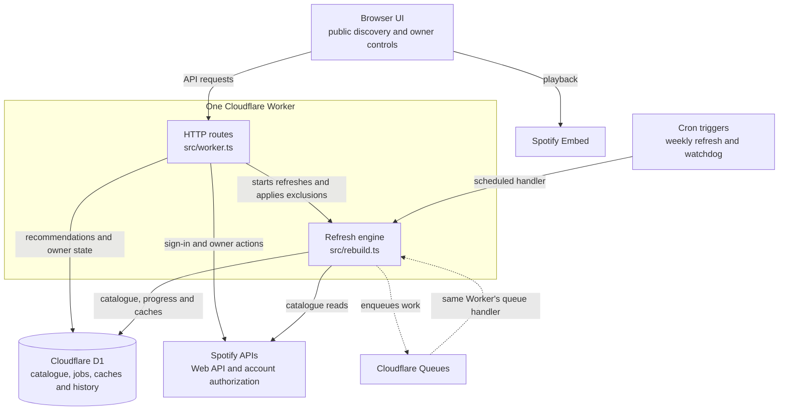

# FERTO

**[Live site](https://ferto.maragkakis-alexandros.workers.dev/)**

A small, self-hosted music-discovery app for finding unfamiliar songs from
artists in one Spotify owner's library.

Anyone can browse the public catalogue with **Next**, without connecting a
Spotify account. The owner can **Add** a song to Spotify Liked Songs or choose
**Never again** to exclude it permanently. Spotify handles listening through
its official embedded player and direct track links.

The interface takes its colours from the current artwork, with light/dark
themes and a neutral favicon.



*Demo screen with fictional music metadata and original cover art. The external
Spotify player is omitted from this documentation image.*

## Try it locally

With Node **24.22.2** and npm **11.19.1** (see [.nvmrc](.nvmrc)), on Linux,
macOS or WSL:

```bash
npm ci
npm run demo
```

Open <http://127.0.0.1:8787>. No Spotify credentials or Cloudflare account are
needed. The demo builds the complete app and seeds three public recordings in
an isolated local database. Artwork and the embedded player load from Spotify;
the demo does not call Spotify's Web API. Stop it with Ctrl-C. Re-running it
resets only `.wrangler/demo-state`.

## Run your own instance

FERTO is a **single-owner app**, rather than a service that connects every
visitor's library. Your catalogue is public, while sign-in and library changes
are restricted to the configured owner. Local development and manual
Cloudflare deployment work from the same checkout.

- [Self-hosting](docs/self-hosting.md): Spotify setup, the two authorization flows, local development, deployment and safe schema upgrades.
- [Configuration](docs/configuration.md): public placeholders, ignored instance settings and runtime secrets.
- [Operations](docs/operations.md): how discovery works, permanent exclusions, refresh progress, quota waits and retained catalogues.
- [Development and checks](docs/development.md): demo details, synthetic simulator, browser tests and release packaging.
- [Backups and recovery](docs/backups-and-recovery.md): free-tier recovery limits, private local exports and restore procedures.
- [Local releases](docs/local-releases.md): verified updates, deployment failure handling and operational status.
- [GitHub CI/CD](docs/ci-cd.md): checks, optional deployment from `main`, encrypted backups and one-time setup.

The stack is a Vite frontend and a Cloudflare Worker with D1 and Queues, using
the Spotify Web API and official Embed. An owner's Spotify app needs to meet
Spotify's current [Development Mode requirements](https://developer.spotify.com/documentation/web-api/concepts/quota-modes).

## Architecture



The HTTP, queue and scheduled handlers run in the same Worker. Public discovery
uses the stored D1 catalogue; background refreshes fetch Spotify data and save
their progress in D1. The catalogue and track caches are D1 tables, and playback
stays in Spotify's embedded player.

For the supporting modules, see the
[generated interactive overview on GitDiagram](https://gitdiagram.com/alexandrosmaragkakis/ferto?utm_source=readme&utm_medium=link).
The [flow diagrams](docs/flows/README.md) describe the implemented sign-in,
discovery, refresh and owner-action paths in more detail.

## Contribute and maintain

See [CONTRIBUTING.md](CONTRIBUTING.md) for small changes and validation, and
[SECURITY.md](SECURITY.md) for reporting vulnerabilities privately. The public
[security overview](docs/application-security.md) describes the implemented
protections; [publication checks](docs/security-checks.md) cover credentials,
history and release artifacts.

Pushes and pull requests run verification without production credentials.
Optional CI/CD deploys verified changes from `main` only after explicit setup
and activation; it is disabled by default. Repository publication does not
connect your Cloudflare account. Manual local deployment remains available.
[Dependency guidance](docs/dependencies.md) explains the review process and
configured update proposals. Deeper architecture is documented in the
[flow diagrams](docs/flows/README.md) and [refresh measurements](docs/refresh-engine.md).

The [development roadmap](docs/roadmap.md) tracks the next improvements to CI,
database retention, versioned releases and recently shown tracks.

## License and assets

The code, documentation and original FERTO branding/illustrations are under the
[MIT License](LICENSE). Spotify logos and music artwork retain their own rights
and terms; see [third-party notices](THIRD_PARTY_NOTICES.md). This is an
independent personal project, with no Spotify affiliation or endorsement.
